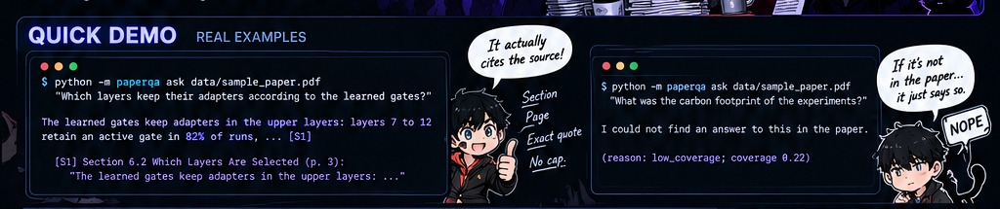
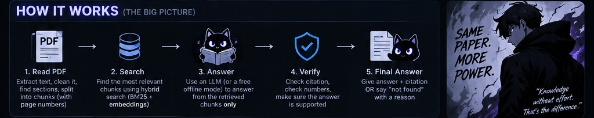
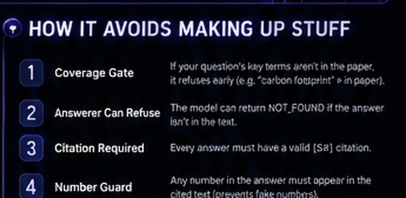
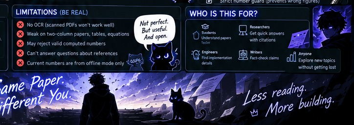

# Paper Q&A Agent


**Turn a research paper into a conversation.** Drop in a text-based PDF, ask a question in normal English, and get an answer that points back to the paper. If the agent cannot find enough evidence, it can say so instead of confidently making something up.

> **The idea:** read less blindly, verify more quickly, and spend your time understanding the ideas—not hunting through 30 pages for one sentence.

## The 20-second explanation

Imagine a research paper is a giant textbook and you only need to know three things. Instead of reading every page, you ask:

- “What problem is this paper trying to solve?”
- “What did the authors find?”
- “Which page supports that claim?”

Paper Q&A Agent searches the PDF, finds passages that look relevant, and builds an answer from those passages. It also tracks where the passages came from, so you can check the source yourself.

It is **not** a magical all-knowing chatbot. It is a document-question-answering tool with checks designed to make its answers easier to verify.

## Table of contents

- [The 20-second explanation](#the-20-second-explanation)
- [What it can do](#what-it-can-do)
- [See what an answer looks like](#see-what-an-answer-looks-like)
- [How it works](#how-it-works--no-phd-required)
- [How the agent tries not to make things up](#how-the-agent-tries-not-to-make-things-up)
- [Get started](#get-started)
- [Offline mode and optional AI add-ons](#offline-mode-vs-optional-ai-add-ons)
- [Measured results](#results-what-has-actually-been-measured)
- [Project structure](#what-is-inside-the-project)
- [Limitations](#limitations--please-read-this-before-relying-on-it)
- [Troubleshooting](#troubleshooting)
- [Future improvements](#ideas-for-future-improvements)

## What it can do

| Feature | In normal human language |
|---|---|
| Read a PDF | Extracts text, sections, and page information from a text-based research paper. |
| Search for evidence | Finds passages that may answer your question. |
| Answer a question | Uses the selected passages to produce an answer. The default offline mode extracts relevant text; an optional Claude backend can generate answers. |
| Show its sources | Adds citations such as `[S1]`, with the section and page, so you can inspect the evidence. |
| Admit when it is stuck | Can refuse to answer when the evidence is weak or a required check fails. |
| Run on your machine | The default offline mode needs no paid API key and does not need to call an online LLM. |
| Offer a web interface | A small Streamlit app lets you upload a PDF and ask questions in a browser. |
| Evaluate itself | Runs a small set of known questions and writes a report so results can be inspected. |

## See what an answer looks like



### Example 1: the paper contains the answer

Run this from the project folder:

```bash
python -m paperqa ask data/sample_paper.pdf "Which layers keep their adapters according to the learned gates?"
```

Example output, shortened for readability:

```text
The learned gates keep adapters in the upper layers: layers 7 to 12
retain an active gate in 82% of runs, ... [S1]

[S1] Section 6.2 Which Layers Are Selected (p. 3):
"The learned gates keep adapters in the upper layers: ..."
```

The important part is not just the answer. It is the **section, page, and supporting passage** that let you check it.

### Example 2: the paper does not contain the answer

```bash
python -m paperqa ask data/sample_paper.pdf "What was the carbon footprint of the experiments?"
```

Example output:

```text
I could not find an answer to this in the paper.

(reason: low_coverage; coverage 0.22)
```

That response is useful. It tells you the agent did not find enough matching evidence. It does **not** prove that the experiments had no carbon footprint; it means the paper, as processed by the tool, did not provide enough evidence for an answer.

---

## How it works — no PhD required



Think of it as a research assistant with a strict checklist:

1. **Open the PDF.** Extract the readable text and keep track of pages and section headings.
2. **Tidy the text.** Remove some repeated page furniture, such as headers and footers, then split the paper into smaller chunks around sentence boundaries.
3. **Find useful chunks.** Search for sections that may contain the answer. The search combines word matching with a second ranking method when appropriate.
4. **Draft an answer.** The default offline answerer picks relevant source text. An optional LLM backend can be used to produce a more natural answer from the retrieved excerpts.
5. **Check the answer.** Look for evidence that the answer is supported, that it has a citation, and that any numbers appear in the cited source.
6. **Return the result.** Give the answer with a citation—or return a refusal with a reason when a check fails.

### Tiny glossary

| Project term | Translation |
|---|---|
| **Chunk** | A small piece of the paper. Searching 120-word pieces is easier than searching an entire document as one giant block. |
| **Embedding** | A numerical representation of text that can help find similar meanings, not just identical words. |
| **BM25** | A search method that is good at matching important words and phrases. |
| **Hybrid search** | Combining different search rankings in the hope of finding better evidence. |
| **Citation** | A pointer back to the section and page that support an answer. |
| **Abstain** | Refuse to answer because the available evidence is not good enough. |
| **Evaluation** | Asking a set of known questions to measure how the tool behaves. |
| **Hallucination** | A claim that sounds plausible but is not supported by the source. |

## How the agent tries not to make things up



No software check is perfect, but this project uses several checks instead of trusting one signal:

### 1. Evidence coverage check

Before answering, the agent looks at how much of the important wording in your question appears in the retrieved passages. If too little is present, it can stop early. For example, asking about a “carbon footprint” should not succeed just because the paper contains the word “experiments.”

### 2. The answerer can refuse

The optional Claude answerer is instructed to return `NOT_FOUND` when its supplied excerpts do not support an answer. The offline extractive answerer also has its own rule for refusing when it cannot find a sentence that matches enough of the question.

### 3. A valid citation is required

An answer without a valid `[S#]` citation can be rejected. A citation makes the answer checkable; it is not a guarantee that the interpretation is correct.

### 4. Number check

The tool checks that numbers in an answer appear in the cited passage. This helps catch made-up statistics, but it has a trade-off: a mathematically valid number calculated from source values may be rejected if that new number does not appear verbatim in the source.

### Refusal reasons you might see

| Reason | What it means |
|---|---|
| `low_coverage` | The retrieved text does not cover enough of the question's important terms. |
| `model_not_found` | The answerer could not find an answer in the supplied passages. |
| `no_valid_citation` | The answer did not include a valid source citation. |
| `unsupported_number` | A number in the answer could not be verified in the cited text. |

**Important:** these checks reduce some kinds of unsupported answers; they do not make the agent infallible. Always open the cited passage before relying on an important claim.

---

## Get started

The commands below assume the project's source files are present and that you are running commands from the project root—the folder containing `pyproject.toml`.

### Before you start

- Install **Python 3.10–3.13**. The project notes say CI checks those versions; local testing was performed on Python 3.13.
- Download or clone the project from its GitHub repository, then open a terminal in the project folder.
- The standard setup uses the offline backend. You do not need an Anthropic API key for the basic commands below.

Python download: <https://www.python.org/downloads/>

### Step 1 — Create a virtual environment

A virtual environment keeps this project's Python packages separate from other Python projects on your computer.

**Windows PowerShell:**

```powershell
python -m venv .venv
.\.venv\Scripts\Activate.ps1
```

**macOS / Linux:**

```bash
python -m venv .venv
source .venv/bin/activate
```

If the activation command is unfamiliar, that is normal. It simply switches your terminal into this project's isolated Python environment.

### Step 2 — Install the project

Run this in the project root:

```bash
python -m pip install -e ".[dev,ui]"
```

This installs the project plus the development/test tools and the web interface dependencies.

### Step 3 — Run the tests (recommended)

```bash
python -m pytest -q
```

The project includes **31 tests** covering areas such as PDF ingestion, search, agent behaviour, LLM behaviour, evaluation metrics, and the UI. The project notes report that the tests do not need a network connection or API key.

### Step 4 — Ask your first question

```bash
python -m paperqa ask data/sample_paper.pdf "What bottleneck dimension do the adapters use?"
```

Try your own question by replacing the text inside quotation marks. Use the included sample PDF first so you can check that the basic setup works before testing your own document.

### Step 5 — Open the web interface (optional)

```bash
streamlit run app.py
```

Streamlit will show a local web address in your terminal. Open that address in your browser, upload a **text-based PDF**, and ask a question.

### Step 6 — Run the evaluation (optional)

```bash
python -m paperqa eval data/sample_paper.pdf
```

The evaluation writes a Markdown report and a JSON file under `results/`, according to the project's current configuration. The report makes it easier to inspect which questions were answered correctly or incorrectly.

---

## Offline mode vs. optional AI add-ons

You can try the basic project without configuring a hosted LLM. There are optional backends for people who want to experiment with stronger language models or semantic search.

| Option | What it changes | What you need to know |
|---|---|---|
| **Offline default** | Uses LSA for its default text representation and an extractive answerer. | Free to run locally and needs no API key. It is deliberately a baseline, not a state-of-the-art semantic search system. |
| **Claude answerer** | Uses Anthropic's model to generate an answer from retrieved passages. | Requires the optional package and your own `ANTHROPIC_API_KEY`. API calls may cost money. |
| **Sentence-transformers embedder** | Adds a neural embedding model for more capable semantic retrieval. | Requires installing the optional package and downloading a model. It is not the zero-download default. |

### Optional: install the Claude backend

```bash
python -m pip install -e ".[llm]"
```

Then provide an API key in the terminal session where you will run the project.

**Windows PowerShell:**

```powershell
$env:ANTHROPIC_API_KEY = "your-api-key"
```

**macOS / Linux:**

```bash
export ANTHROPIC_API_KEY="your-api-key"
```

Do not paste your real key into the README, commit it to GitHub, or share it in screenshots. Keep it private.

The project README documents this example for evaluating with Claude:

```bash
python -m paperqa eval data/sample_paper.pdf --llm anthropic --out results_claude
```

### Optional: install sentence-transformers embeddings

```bash
python -m pip install -e ".[embeddings]"
```

The model needs to be downloaded. The project README documents this evaluation command for using sentence-transformers embeddings with the offline answerer:

```bash
python -m paperqa eval data/sample_paper.pdf --embedder st --llm extractive --out results_st
```

### A note about measured results

The Claude answerer and sentence-transformers embedder are described as implemented and unit-tested against fakes, but **they were not evaluated in the environment used to produce the original project results**. The reported scores below come from the offline LSA + extractive setup. Do not treat the offline results as evidence that the optional backends achieve the same scores—or better scores—until you run their evaluations.

---

## Results: what has actually been measured?

The project was evaluated on **29 questions about one synthetic, three-page paper**: 23 questions had answers in the paper, and 6 did not. The reported setup used the LSA embedder, the extractive answerer, `top_k=5`, and 18 chunks.

### End-to-end results

| Split | Answer accuracy | False-abstain rate | Correctly refused unanswerable questions | Wrong answers among produced answers | Citation hit |
|---|---:|---:|---:|---:|---:|
| Development (10 questions) | 75.0% | 25.0% | 100% | 0.0% | 100% |
| Test (19 questions) | 86.7% | 6.7% | 50.0% | 7.1% | 92.9% |
| All (29 questions) | 82.6% | 13.0% | 66.7% | 5.0% | 95.0% |

### Search results

For answerable questions, a retrieval hit means a returned chunk contained the expected evidence text.

| Search method | Hit@1 | Hit@3 | Hit@5 | MRR |
|---|---:|---:|---:|---:|
| BM25 word search | 73.9% | 91.3% | 95.7% | 0.837 |
| Dense search with offline LSA | 82.6% | 91.3% | 95.7% | 0.880 |
| Hybrid search (rank fusion) | 82.6% | 91.3% | 95.7% | 0.880 |

### How to interpret those numbers

- **They are a baseline, not a leaderboard score.** There is only one small synthetic paper and 29 questions.
- **The main weakness was knowing when not to answer.** On the test split, the agent correctly refused only 50% of the unanswerable questions. It sometimes confused “the paper mentions evaluation” with “the paper reports a human evaluation.”
- **Hybrid search did not beat dense search in this small experiment.** That does not prove it will never help; this test is too small to make a broad claim.
- **Paraphrases can be difficult for the offline setup.** The default LSA representation is not a modern neural semantic model, so different wording can hide a relevant passage.
- **The test split is tiny.** One question changes a percentage noticeably. Results on real papers may be very different.

The offline retrieval-and-answer pipeline was reported at a median of about **1.3 ms per question** and a 95th-percentile of about **1.5 ms**, excluding index construction. Building the index for the sample paper took about **1.2 seconds**. Those timings are for the small offline test setup, not for a hosted LLM; Claude latency and cost were not measured.

## What is inside the project?

The source project is organized into small pieces so each part has one main job.

```text
paperqa/
├── ingest.py      # Read and clean PDF text; find sections and pages
├── index.py       # Build the searchable index and rank passages
├── llm.py         # Offline answerer and optional Anthropic answerer
├── agent.py       # Coordinate search, checks, citations, and answers
├── evaluate.py    # Run the evaluation and create reports
├── cli.py         # Commands you run from the terminal
├── text.py        # Text-processing helpers
└── config.py      # Configuration

app.py             # Browser-based Streamlit interface
eval/              # Questions used to test the agent
data/              # Synthetic sample paper
tests/              # Automated tests
results/            # Evaluation reports
docs/demo.md        # Example terminal session
LEARNINGS.md        # Known problems and lessons from the evaluation
pyproject.toml      # Python package configuration
```

Some filenames and folder names may appear slightly differently if the project is changed later; the list above describes the layout documented for this version.

## Limitations — please read this before relying on it



This project is useful for experimenting with grounded document Q&A, but it has real limitations:

- **Scanned PDFs are not supported by OCR.** If a PDF is just photographs of pages, text extraction may return little or nothing.
- **Complex layouts can confuse extraction.** Two-column papers, equations, and tables may be read in the wrong order or flattened into text that loses its structure.
- **It handles one document at a time.** It does not currently search across a whole library of papers.
- **References are excluded from search.** That helps avoid bibliography noise, but it means the agent cannot reliably answer questions such as “Who wrote reference 2?”
- **Citations identify a chunk, section, and page.** They do not point to an exact character range in the PDF.
- **The evaluation's answer checking is simple.** It checks expected text, which can unfairly mark a correct paraphrase wrong or miss subtleties a human reviewer would notice.
- **The example paper is synthetic.** The scores do not demonstrate performance on real research papers.
- **A citation is not proof that an interpretation is right.** Open the cited passage and check whether it really supports the claim.

For medical, legal, financial, or other high-stakes research, treat the agent as a navigation aid—not as a substitute for checking the original paper or getting appropriate expert review.

## Troubleshooting

### `No module named paperqa`

Make sure you are in the project root (the folder containing `pyproject.toml`), have activated the intended virtual environment, and ran:

```bash
python -m pip install -e ".[dev,ui]"
```

### `python` is not found

Install Python from <https://www.python.org/downloads/>. On some Windows computers, the command `py` works instead of `python`; if so, use `py -m venv .venv` to create the environment and keep using the Python command associated with that environment.

### The web interface command is not found

Confirm the optional UI dependencies were installed. You can also try launching Streamlit through the active Python environment:

```bash
python -m streamlit run app.py
```

### It says “I could not find an answer” for something I know is in the paper

That can happen. Try asking a more specific question using the wording from the paper. Check whether the PDF text extracts correctly, then open the cited sections or inspect the relevant chunks. The offline semantic search is intentionally simple and can miss paraphrases or information hidden in tables.

### A number is rejected even though I calculated it correctly

The number guard looks for the number in cited passages. It may reject newly calculated numbers that do not appear in the source exactly as written. This is a known trade-off documented by the project.

### Do I need an API key?

No—not for the default offline setup. You only need an Anthropic API key if you choose to use the optional Claude answerer. Remember that hosted API use may incur charges.

## Who might find this useful?

- **Students:** get oriented in a paper before reading it closely.
- **Researchers:** locate claims and relevant passages more quickly.
- **Engineers:** search for implementation details, parameters, and reported results.
- **Writers and reviewers:** trace statements back to the source before repeating them.
- **Anyone learning AI:** explore PDF parsing, retrieval, citations, refusal checks, and evaluation in one project.

## Ideas for future improvements

The original project notes point to several sensible next steps:

- Test against more real papers and a larger, better-balanced question set.
- Include unanswerable questions that are *related to the topic*, not only questions about entirely unrelated topics.
- Evaluate the optional neural embedder and Claude answerer on the same set, then publish the results honestly.
- Improve semantic retrieval for paraphrases.
- Improve extraction for tables, equations, and multi-column layouts.
- Use more careful evaluation, such as human review, instead of relying only on exact-string checks.
- Make citation spans more precise and easier to inspect in the PDF.

## License

The original README specifies the **MIT License**. Include the project's `LICENSE` file in the repository so the terms are available to users.

---

<p align="center">
  <strong>Same paper. Different you.</strong><br>
  Less hunting through pages. More checking the evidence. More time building.
</p>
