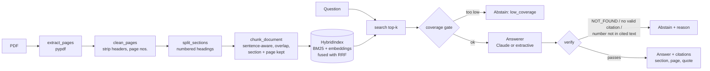

# Paper Q&A Agent

An agent that reads a research paper (PDF), answers questions **using evidence from the paper**, **cites the section and page** each answer came from, and **says so when the paper does not contain the answer**.

```
$ python -m paperqa ask data/sample_paper.pdf "Which layers keep their adapters according to the learned gates?"
The learned gates keep adapters in the upper layers: layers 7 to 12 retain an active gate in 82% of runs, ... [S1]

  [S1] Section 6.2 Which Layers Are Selected (p. 3): "The learned gates keep adapters in the upper layers: ..."

$ python -m paperqa ask data/sample_paper.pdf "What was the carbon footprint of the experiments?"
I could not find an answer to this in the paper.
  (reason: low_coverage; coverage 0.22)
```

More runs, including a failure, are in [`docs/demo.md`](docs/demo.md) (generated from real CLI output).

> **Read this first: what has and has not been measured.**
> The build environment had no `ANTHROPIC_API_KEY` and no access to the HuggingFace model hub. So every number below comes from the **offline backend** (LSA embeddings + an extractive answerer). The Claude answerer and the sentence-transformers embedder are implemented and unit-tested against fakes, but **they have not been evaluated**. Section [Reproduce with real models](#reproduce-with-real-models) gives the two commands to measure them. The eval set is also small (29 questions, one synthetic paper), so treat the numbers as a baseline and a working harness, not as a benchmark.

## Quick start

```bash
python -m venv .venv && source .venv/bin/activate
pip install -e ".[dev,ui]"          # core + pytest + streamlit
python -m pytest -q                  # 31 tests, ~2 s, no network or API key needed
python -m paperqa ask data/sample_paper.pdf "What bottleneck dimension do the adapters use?"
streamlit run app.py                 # web UI (upload any text-based PDF)
python -m paperqa eval data/sample_paper.pdf   # writes results/eval_report.md + eval_results.json
```

Tested on Python 3.13 with pypdf 6.17, scikit-learn 1.9, numpy 2.5, streamlit 1.66, anthropic 2.3. CI (`.github/workflows/ci.yml`) runs the tests on 3.10 to 3.13 on every push; I could only run 3.13 locally.

Optional backends:

```bash
pip install -e ".[llm]"              # Claude answerer   (export ANTHROPIC_API_KEY=...)
pip install -e ".[embeddings]"       # sentence-transformers embeddings
```

## Architecture



| Module | Responsibility |
|---|---|
| `paperqa/ingest.py` | PDF text, header/footer removal, section detection, sentence-aware chunking with page tracking |
| `paperqa/index.py` | BM25, pluggable embedders (offline LSA / sentence-transformers), reciprocal-rank-fusion hybrid search |
| `paperqa/llm.py` | `AnthropicLLM` (grounded prompt, `NOT_FOUND` contract) and `ExtractiveLLM` (offline baseline) |
| `paperqa/agent.py` | Retrieval gate, optional query rewrite, citation parsing, hallucination guard, `Answer` objects |
| `paperqa/evaluate.py` | Retrieval and end-to-end metrics, dev/test split, markdown report |
| `app.py`, `paperqa/cli.py` | Streamlit UI and CLI (`ask`, `chat`, `chunks`, `eval`) |

### How "admit when it cannot find an answer" works

Abstention is layered so that no single check has to be perfect:

1. **Coverage gate.** The IDF-weighted share of the question's content terms found in the retrieved passages. Terms that never occur in the paper get the maximum weight, so "carbon footprint" scores low even though "experiments" matches. Below the threshold, the agent refuses without calling the LLM.
2. **The answerer can refuse.** Claude is told to reply exactly `NOT_FOUND` if the excerpts do not contain the answer; the extractive answerer refuses if no sentence covers enough question terms.
3. **Citation required.** An answer with no valid `[S#]` citation is rejected.
4. **Number guard.** Every number in the answer must appear in the cited passages. This catches the most damaging hallucination (a plausible wrong figure) cheaply, at the cost of also rejecting answers that compute a new number.

Every refusal carries a machine-readable `reason` (`low_coverage`, `model_not_found`, `no_valid_citation`, `unsupported_number`), which the UI and eval use.

## Design decisions and trade-offs

| Decision | Why | Cost / alternative |
|---|---|---|
| Chunk on **sentence boundaries** within **sections**, ~120 words, 1-sentence overlap | Evidence stays whole and citations can name a section and page | Fixed-size windows are simpler but split facts and lose section identity |
| Section title **prepended** to each chunk for retrieval | Lets "limitations" or "ablation" in a query match the right section | Slightly biases lexical scores toward headings |
| **Hybrid** retrieval (BM25 + dense, RRF) | Lexical wins on exact numbers and names, dense on paraphrase; RRF needs no score calibration | On this tiny paper it measured no better than dense alone (see results). The benefit is expected to show on longer papers; I have not measured it |
| **Offline LSA** as the default embedder | Reproducible with zero downloads, so tests and eval run anywhere | LSA learns co-occurrence from one 3-page paper only; it is not real semantic similarity. `--embedder st` swaps in a neural model |
| **Extractive** answerer as the default fallback | Deterministic, free, cannot hallucinate text, and a useful non-LLM baseline | It returns the nearest sentence, so it is weak on abstention for in-topic questions (see failures) and on paraphrase |
| `References` section **excluded** from the index | Keeps bibliography noise out of retrieval | The agent cannot answer "who wrote reference 2" |
| `pypdf` for extraction | Pure Python, easy install | No OCR, weak on two-column layouts, equations and tables (tables come out as a flat row of cells) |
| Strict **number guard** | Prevents confident wrong figures | Rejects legitimate answers that derive a new number |

## Results

Backend: `embedder=lsa`, `answerer=ExtractiveLLM`, `top_k=5`, 18 chunks. Source: [`results/eval_report.md`](results/eval_report.md) (full per-question records in `results/eval_results.json`).

The eval set ([`eval/eval_set.json`](eval/eval_set.json)) has 29 questions on a **synthetic** paper whose facts are known: 23 answerable (single facts, lists, paraphrases, a table-only fact, a yes/no) and 6 unanswerable (3 off-topic, 3 *in-topic but absent from the paper*, e.g. "What macro-F1 does LoRA achieve on FoodReviews?"). Questions are split into **dev** (10, used to choose the two abstention thresholds) and **test** (19, read once after thresholds were fixed).

**Retrieval** (answerable questions; a chunk counts as a hit if it contains the gold evidence string):

| mode | hit@1 | hit@3 | hit@5 | MRR |
|---|---|---|---|---|
| BM25 only | 73.9% | 91.3% | 95.7% | 0.837 |
| dense (LSA) only | 82.6% | 91.3% | 95.7% | 0.880 |
| hybrid (RRF) | 82.6% | 91.3% | 95.7% | 0.880 |

**End-to-end:**

| split | answer accuracy | false-abstain | abstain recall (unanswerable) | wrong when answering | citation hit |
|---|---|---|---|---|---|
| dev (8 ans. / 2 unans.) | 75.0% | 25.0% | 100% | 0.0% | 100% |
| **test** (15 ans. / 4 unans.) | **86.7%** | 6.7% | **50.0%** | 7.1% | 92.9% |
| all (23 / 6) | 82.6% | 13.0% | 66.7% | 5.0% | 95.0% |

Definitions: *answer accuracy* = answerable questions answered with every required fact; *abstain recall* = unanswerable questions correctly refused; *wrong when answering* = share of produced answers that were incorrect; *citation hit* = answered questions where a cited chunk contains the gold evidence.

**Latency and cost.** Offline pipeline: p50 1.3 ms and p95 1.5 ms per question (retrieval + answering, excluding index build); building the index for the 3-page paper takes about 1.2 s. Cost is $0. With the Claude answerer, each query sends about 650 input tokens on average (measured as characters / 4 over the eval prompts) plus a short answer, so cost and latency will be dominated by the API call; I have not measured them.

**Accuracy by question type** (n is small): single facts 100% (16), absent topics 100% (3), table-only fact 100% (1), lists 50% (2), paraphrases 33% (3), in-topic unanswerable 33% (3), yes/no 0% (1).

### What the results say, honestly

- **The headline weakness is in-topic unanswerable questions.** Test abstain recall is 50%: for "accuracy on MNLI" and "did the authors run a human evaluation?", the extractive answerer returned the nearest sentence about accuracy / evaluation. Matching on words cannot tell "the paper mentions evaluation" from "the paper reports a human evaluation".
- **A tuning blind spot cost me.** The dev split only contained off-topic unanswerables, so lowering the thresholds to 0.3 looked free on dev (100% abstain recall) and then hurt on test. I did not retune on test; the thresholds stay as chosen, and the failure is documented rather than hidden. The fix is a better eval design (see `LEARNINGS.md`), not a lower number.
- **Hybrid retrieval did not beat dense here.** With 18 chunks and 23 questions, hit@3 and hit@5 are identical across all three modes and one question is worth 4.3 points. This is no evidence for or against hybrid retrieval on real papers.
- **Paraphrase questions fail** because the offline stack has no real semantic model ("halt" vs "stops", "very little data" vs "100 examples"). This is exactly what a neural embedder plus an LLM is for, but I have not measured that.
- **Small-sample caveat.** On the 15-question test split, one question is 6.7 points; the dev/test gap is within what chance alone can produce.

## Reproduce with real models

```bash
# Real embeddings, offline answerer (isolates the retrieval effect):
python -m paperqa eval data/sample_paper.pdf --embedder st --llm extractive --out results_st

# Claude as the answerer (needs ANTHROPIC_API_KEY; model via Config.model, default claude-sonnet-5-5):
ANTHROPIC_API_KEY=... python -m paperqa eval data/sample_paper.pdf --llm anthropic --out results_claude
```

`results/` will then hold a comparable report for each backend. To use your own paper, write an eval set in the same JSON format (`question`, `answerable`, `evidence`, `must_include`, `split`, `type`) and pass `--eval-set`.

## Project layout

```
paperqa/        ingest.py  index.py  llm.py  agent.py  evaluate.py  cli.py  text.py  config.py
app.py          Streamlit UI
eval/           eval_set.json (29 questions, dev/test split)
data/           sample_paper.pdf (synthetic, generated by scripts/make_sample_paper.py)
tests/          31 tests: ingestion, retrieval, agent behaviour, LLM contract, eval metrics, UI
results/        latest eval report (markdown + json)
docs/demo.md    real CLI transcript (regenerate with scripts/make_demo.sh)
LEARNINGS.md    what I learned and what I would improve next
```

## Limitations

- Text-based PDFs only (no OCR); two-column text, equations and tables extract imperfectly.
- Single-document Q&A; no cross-paper retrieval.
- Citations point to a chunk, section and page, not to character offsets in the PDF.
- Answer correctness in the eval is string-based (`must_include`), which can miss correct paraphrased answers; an LLM judge or human review would be more faithful.
- The sample paper is synthetic, so these numbers say nothing about performance on real papers.

## License

MIT
