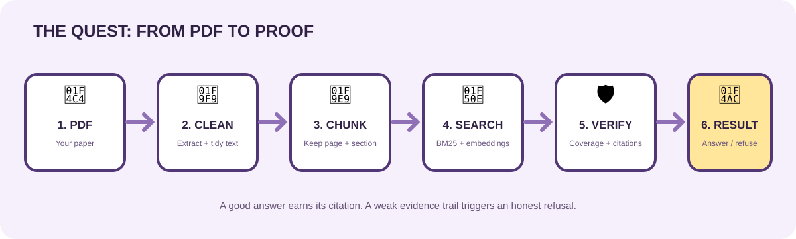
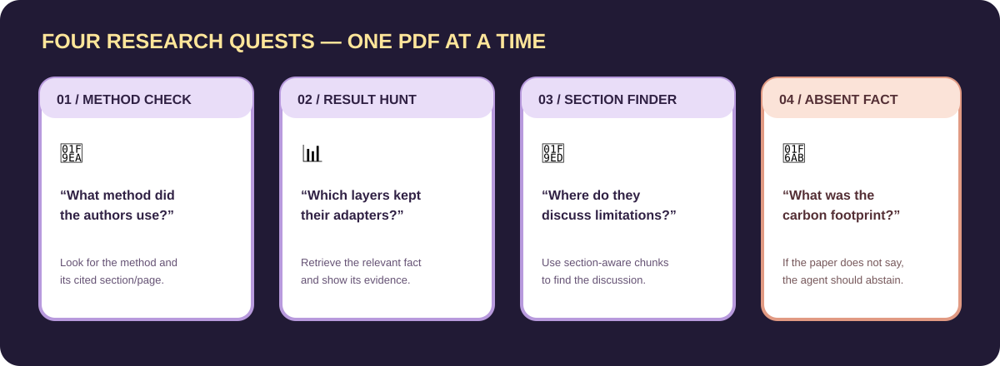
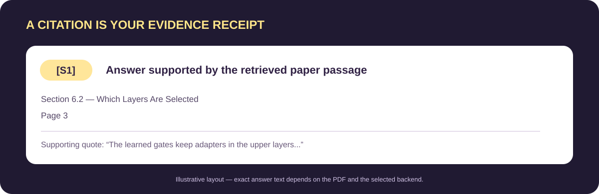
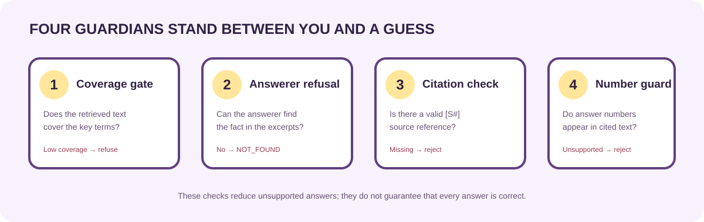

# Paper Q&A Agent

**[Documentation map](docs/README.md)** · [Contribution guide](CONTRIBUTING.md) · [Security policy](SECURITY.md)

<p align="center">
  
</p>

<p align="center"><strong>Your research-paper sidekick: ask a PDF a question, get an answer with a page and section to check — or get an honest “I couldn't find that.”</strong></p>

<p align="center">
  <a href="https://github.com/yerageracharan/paper-qa-agent/actions/workflows/ci.yml"></a>
  
  
  
  
</p>

> **New-reader note:** This repository contains the application source code, sample PDF, tests, evaluation files, and this guide. Follow the steps from the repository's root folder — the one containing `pyproject.toml` and `app.py`.

## The opening scene: why this agent exists

Ever opened a 30-page research paper, searched for one tiny result, and thought: **“WHERE IS THAT ONE SENTENCE?!”**

That is the boss fight this project is designed to make easier.

Paper Q&A Agent takes a **text-based PDF**, extracts and organises its text, searches for passages related to your question, then returns an answer with citations such as `[S1]`. Each citation points to a section, page, and supporting quote. When the evidence is too weak or missing, the agent can refuse instead of pretending to know.

**The guild rule: no evidence, no victory speech.**

### What it can do

- Read one text-based research-paper PDF at a time.
- Clean extracted text and split it into section-aware chunks while keeping page numbers.
- Search with BM25 keyword retrieval and embeddings, then combine rankings with Reciprocal Rank Fusion (RRF).
- Check whether retrieved passages cover the important terms in your question.
- Return answers with `[S#]` citations, section, page, and a supporting passage.
- Refuse with a reason when checks fail.
- Run from a terminal or through a Streamlit web interface.
- Run an evaluation suite and unit tests.

### What it does *not* promise

- A citation does not automatically prove that an answer is correct. Open the paper and check it.
- Scanned, image-only PDFs are not supported by the current extraction path (there is no OCR).
- Two-column layouts, tables, and equations may extract imperfectly.
- It handles one paper at a time; it is not a multi-paper research library.

## 1. See the mission map before installing anything

<p align="center"></p>

The pipeline has six stages:

1. **PDF enters the arena.** The program extracts selectable text page by page.
2. **Text gets cleaned.** It removes some repeated headers, footers, and page-number noise.
3. **The paper becomes chunks.** Passages are split around sentences and sections; page information is retained.
4. **Search finds candidates.** BM25 and embedding search produce rankings; RRF combines them.
5. **The evidence gets challenged.** The agent checks coverage, citations, and numbers.
6. **A result appears.** It returns a cited answer or an abstention reason.

### Vocabulary, translated into human

| Project term | Rookie-friendly translation |
|---|---|
| PDF extraction | Turning selectable PDF text into text the program can search. |
| Chunk | A small passage of the paper. Think of it as one evidence card. |
| BM25 | Keyword search. Strong when the question uses the same words as the paper. |
| Embedding | A list of numbers representing text, used to compare passages by similarity. |
| LSA | The offline TF-IDF + SVD method used by the default embedder. It learns word co-occurrence in this paper; it is not a pretrained neural model. |
| Sentence Transformers | An optional pretrained neural embedding model. |
| Hybrid retrieval | Combining keyword and embedding rankings. |
| RRF | Reciprocal Rank Fusion — a method for combining ranked lists. |
| Coverage gate | A check for whether the retrieved passages contain enough of the question's key terms. |
| Abstention | The agent says it cannot support an answer. This is intentional, not a crash. |

## 2. Before the first summon: what you need

| Requirement | What to prepare |
|---|---|
| Python | Python 3.10 or newer. CI is configured for Python 3.10–3.13. |
| Terminal | PowerShell on Windows, or Terminal on macOS/Linux. |
| Git | Optional if you download the repository ZIP instead of cloning. |
| PDF | Start with the included `data/sample_paper.pdf`. Use a text-based PDF for your own tests. |
| API key | Not required for the offline baseline. Anthropic is optional. |
| Internet | Needed to install packages and, if selected, download the optional Sentence Transformers model. |

### Check Python

**Windows PowerShell:**

```powershell
py --version
```

**macOS / Linux:**

```bash
python3 --version
```

If Python is not recognised, install Python 3.10+ and reopen your terminal. On Windows, enable the option to add Python to PATH during installation.

## 3. Install it step by step — no speed-running

### Step 1 — Get the project

**Option A: Download ZIP (beginner-friendly)**

1. On the GitHub repository page, press **Code**.
2. Choose **Download ZIP**.
3. Extract the ZIP to a folder you can find, such as `Documents/paper-qa-agent`.
4. Open that extracted folder.

**Option B: Clone with Git**

```bash
git clone https://github.com/yerageracharan/paper-qa-agent.git
cd paper-qa-agent
```

**Important:** your terminal must be inside the project root. You should see `pyproject.toml`, `app.py`, and the `paperqa/` folder there.

### Step 2 — Create a virtual environment

A virtual environment gives this project its own package room. It prevents its Python libraries from messing with other projects.

**Windows PowerShell:**

```powershell
py -3 -m venv .venv
```

**macOS / Linux:**

```bash
python3 -m venv .venv
```

### Step 3 — Activate the environment

**Windows PowerShell:**

```powershell
.\.venv\Scripts\Activate.ps1
```

**Windows Command Prompt:**

```bat
.venv\Scripts\activate.bat
```

**macOS / Linux:**

```bash
source .venv/bin/activate
```

A successful activation commonly adds `(.venv)` to the beginning of your terminal prompt.

### Step 4 — Upgrade pip

```bash
python -m pip install --upgrade pip
```

### Step 5 — Install the project

```bash
pip install -e ".[dev,ui]"
```

This installs the application, its development/test tools, and Streamlit. The default setup uses the offline LSA embedder and extractive answerer; you do not need a paid LLM key.

### Step 6 — Run the tests

```bash
python -m pytest -q
```

The repository's supplied evaluation notes report **31 tests**. Running the command above checks the code in your own environment; the reported count is not a claim that every possible PDF or question will work perfectly.

### Step 7 — Ask the sample paper a question

```bash
python -m paperqa ask data/sample_paper.pdf "Which layers keep their adapters according to the learned gates?"
```

You should see an answer (when supported) followed by a citation reference such as `[S1]`, with section, page, and quote.

### Step 8 — Open the visual app

```bash
streamlit run app.py
```

The terminal prints a local web address. Open that address in your browser. The app includes a sidebar for uploading a PDF and selecting the answerer, embedder, and number of passages to retrieve. By default, it uses the bundled synthetic sample paper when no upload is selected.

## 4. First research missions: try these questions

<p align="center"></p>

### Mission A — Find a fact that is in the paper

```bash
python -m paperqa ask data/sample_paper.pdf "Which layers keep their adapters according to the learned gates?"
```

A successful answer should include a source marker like `[S1]`. The citation information shows the section and page, plus a supporting quote. Follow that citation into the PDF and decide whether the quote really supports the answer.

<p align="center"></p>

### Mission B — Ask about a fact that the paper does not report

```bash
python -m paperqa ask data/sample_paper.pdf "What was the carbon footprint of the experiments?"
```

The supplied README's example output is:

```text
I could not find an answer to this in the paper.
(reason: low_coverage; coverage 0.22)
```

Exact coverage values and latency may vary with the code and environment. The important behaviour is that the agent can abstain rather than invent a number.

### Mission C — Explore the other CLI commands

```bash
python -m paperqa --help
python -m paperqa chat data/sample_paper.pdf
python -m paperqa chunks data/sample_paper.pdf
python -m paperqa eval data/sample_paper.pdf
```

- `ask` — ask one question.
- `chat` — ask several questions in an interactive terminal session.
- `chunks` — inspect the passages created from the PDF.
- `eval` — run the evaluation set and write a report.

For a machine-readable answer, add `--json` to an `ask` command. Common options include `--embedder lsa|st`, `--llm auto|extractive|anthropic`, and `--top-k`.

## 5. How does it avoid making stuff up?

<p align="center"></p>

The checks are layered:

1. **Coverage gate.** It estimates how much of the question's important vocabulary appears in the retrieved passages. Clearly weak coverage can trigger an early refusal.
2. **Answerer refusal.** The optional Claude answerer is instructed to return `NOT_FOUND` when the excerpts do not contain the answer. The offline extractive answerer also refuses when its best sentence does not cover enough question terms.
3. **Citation required.** An answer without a valid `[S#]` citation is rejected.
4. **Number guard.** Every number in the answer must occur in the cited passages. This helps catch unsupported figures, but can also reject a valid calculation that produces a new number.

Refusal reasons used by the project include `low_coverage`, `model_not_found`, `no_valid_citation`, and `unsupported_number`.

**Important:** these checks reduce certain failure modes. They do not prove that every answer is correct. Check the cited passage yourself.

An experimental, opt-in question-anchor guard is also available. It checks for missing all-caps acronyms, mixed-case technical names such as LoRA, and explicit human-evaluation evidence before generating an answer. In the 29-question synthetic evaluation it corrected two in-topic false answers without changing answerable accuracy or false-abstention rate. It remains disabled by default because it is a narrow lexical rule, not a general entailment model. See [the guard experiment report](docs/ANCHOR_GUARD_EXPERIMENT.md).

## 6. Optional power-ups: use real models

### Option A — Keep the offline baseline

Do nothing extra. The default configuration uses LSA embeddings and the extractive answerer. It is free to run after dependencies are installed and needs no hosted LLM API key.

### Option B — Add Sentence Transformers embeddings

Install the optional package:

```bash
pip install -e ".[embeddings]"
```

Then choose the neural embedder in a CLI command:

```bash
python -m paperqa ask data/sample_paper.pdf "What method do the authors use?" --embedder st
```

The configured model is `sentence-transformers/all-MiniLM-L6-v2`. The first run may download model files, so internet access is needed then. This path has not been benchmarked in the supplied evaluation results.

**Measured comparison (November 2026):** the repository now includes a controlled LSA-versus-Sentence-Transformers experiment. On the current 29-question synthetic-paper evaluation, Sentence Transformers did not improve end-to-end answer accuracy or abstention. Its standalone dense retrieval was weaker than LSA; its hybrid retrieval improved Hit@3 slightly but lowered Hit@1 and MRR. The detailed report is in [docs/BACKEND_COMPARISON.md](docs/BACKEND_COMPARISON.md). Do not change the default embedder based on this small sample.

#### Compare LSA with Sentence Transformers

The repository now includes a controlled comparison runner. It evaluates both embedding backends against the same PDF and 29-question evaluation set while keeping the extractive answerer, top-k value, and scoring rules fixed.

Install the optional neural-embedding dependency and run:

~~~powershell
python -m pip install -e ".[dev,embeddings]"
python scripts/evaluate_backends.py --pdf data/sample_paper.pdf --eval-set eval/eval_set.json --llm extractive --top-k 5 --out results/backend-comparison
~~~

The script writes a side-by-side Markdown report and JSON file, plus each backend's full evaluation output. The first use of the st backend downloads the public model. This requires internet access but no Anthropic API key. The GitHub Actions workflow named **Compare Paper Q&A embedding backends** runs the same comparison and uploads its reports as a downloadable artifact.

The answerer is deliberately fixed to the offline extractive mode for this experiment. The experiment isolates the effect of changing embeddings; it does not measure Claude or API cost. The workflow's first result must be inspected before making any performance claim.

### Option C — Use Anthropic as the answerer

Install the optional dependency:

```bash
pip install -e ".[llm]"
```

Set your API key in the terminal. Do not paste it into source code or commit it to GitHub.

**Windows PowerShell:**

```powershell
$env:ANTHROPIC_API_KEY = "your-api-key"
```

**macOS / Linux:**

```bash
export ANTHROPIC_API_KEY="your-api-key"
```

Run a question using Claude:

```bash
python -m paperqa ask data/sample_paper.pdf "What did the authors find?" --llm anthropic
```

The `auto` answerer uses Anthropic when the key and optional package are available; otherwise it falls back to the offline extractive answerer. API usage may cost money. The supplied evaluation notes do **not** report measured Claude latency or cost, so check your own provider usage.

## 7. Evaluation: what has actually been measured?

The supplied evaluation uses **29 questions** about one **synthetic three-page paper**: 23 answerable and 6 unanswerable. Ten questions are in the development split and 19 are in the test split. This is a useful project baseline, not proof of performance on real academic papers.

### Retrieval results on answerable questions

| Search mode | Hit@1 | Hit@3 | Hit@5 | MRR |
|---|---:|---:|---:|---:|
| BM25 only | 73.9% | 91.3% | 95.7% | 0.837 |
| Dense (offline LSA) | 82.6% | 91.3% | 95.7% | 0.880 |
| Hybrid (RRF) | 82.6% | 91.3% | 95.7% | 0.880 |

### End-to-end results

| Split | Answer accuracy | False-abstain | Abstain recall on unanswerable | Wrong when answering | Citation hit |
|---|---:|---:|---:|---:|---:|
| Development | 75.0% | 25.0% | 100% | 0.0% | 100% |
| **Test** | **86.7%** | **6.7%** | **50.0%** | **7.1%** | **92.9%** |
| All | 82.6% | 13.0% | 66.7% | 5.0% | 95.0% |

### Read the results like a scientist

- The main weakness is **in-topic but unanswerable questions**. Test abstention recall was 50%: the system sometimes found related words and returned a nearby sentence even though the paper did not state the requested fact.
- The development set contained off-topic unanswerable questions, so threshold tuning there did not reveal the same weakness.
- Hybrid retrieval did not beat dense retrieval on this small dataset. The measurements do not prove hybrid retrieval is better on real papers.
- The answerer and neural embedding backends are optional; the supplied evaluation results are for the offline LSA + extractive setup. The Claude and Sentence Transformers paths were not evaluated in those results.
- The sample size is small. One test question changes a percentage by around 6.7 points.

Re-run the evaluation with:

```bash
python -m paperqa eval data/sample_paper.pdf
```

The documented command writes a Markdown report and JSON results under `results/`.

## 8. Real app screenshots — what is and is not shown

The diagrams in this README are **illustrations of the workflow and example output**, not screenshots of the running app. I have not included fabricated UI screenshots or passed mockups off as real captures.

To add real screenshots after launching Streamlit, save these files in `assets/screenshots/`:

| Filename | Capture this real app state |
|---|---|
| `01-upload-paper.png` | Streamlit app open with the bundled sample PDF or a text-based PDF uploaded. |
| `02-cited-answer.png` | The app showing Mission A's question and a cited answer. |
| `03-honest-refusal.png` | The app showing Mission B's refusal and reason. |

**Windows:** use `Win + Shift + S` to capture the app area. **macOS:** use `Shift + Command + 4`. Close unrelated windows and hide API keys or personal information before saving a screenshot. Place the images in the folder above, then add Markdown image links here.

## 9. Project structure

```text
paper-qa-agent/
├── app.py                  # Streamlit interface
├── paperqa/
│   ├── ingest.py           # PDF extraction, cleanup, sections, chunks
│   ├── index.py            # BM25, embeddings, hybrid retrieval, RRF
│   ├── llm.py              # Anthropic and offline extractive answerers
│   ├── agent.py            # retrieval, evidence checks, citations/refusals
│   ├── evaluate.py         # evaluation metrics and report generation
│   ├── cli.py              # ask, chat, chunks, eval commands
│   ├── text.py             # text helpers
│   └── config.py           # tunable settings
├── data/                   # synthetic sample PDF
├── eval/                   # 29-question evaluation set
├── tests/                  # unit tests
├── results/                # saved evaluation results
├── docs/                   # demo notes
├── scripts/                # sample/demo helper scripts
├── assets/                 # README illustrations and screenshots
├── LEARNINGS.md            # what worked, what failed, what to improve
├── pyproject.toml          # package and dependency settings
└── LICENSE                 # MIT license
```

## 10. Limitations — read before trusting the sidekick

- **Text-based PDFs only:** scanned/image-only PDFs need OCR, which this version does not include.
- **Complex layouts:** two-column text, equations, and tables may extract imperfectly; tables can become flattened text.
- **Single document:** no cross-paper search in this version.
- **Citation granularity:** citations identify a chunk, section, and page, not exact character positions.
- **Small synthetic benchmark:** evaluation uses one synthetic paper and 29 questions, not a large set of real publications.
- **String-based scoring:** `must_include` can mark a valid paraphrase as incorrect.
- **Strict number guard:** it may reject a correct calculation if the calculated number is not literally in the cited passage.
- **Offline LSA is a baseline:** it captures co-occurrence within the document; it is not a pretrained neural semantic model.

Use this as a research assistant, not an academic authority. Verify important claims against the original paper before using them in coursework, reports, or publications.

## 11. Troubleshooting dojo

### `python` or `py` is not recognised

Install Python 3.10+ and reopen the terminal. On Windows, try `py --version`; on macOS/Linux, try `python3 --version`.

### `No module named paperqa`

Your virtual environment may not be active, or you may not be in the project root. Activate `.venv`, move to the folder containing `pyproject.toml`, then run:

```bash
pip install -e ".[dev,ui]"
```

### `streamlit` is not recognised

Activate `.venv` and install the UI extra:

```bash
pip install -e ".[dev,ui]"
```

### PowerShell blocks environment activation

Use the Command Prompt activation command from Step 3, or follow your organisation's approved PowerShell policy guidance. Avoid changing machine-wide security settings just for this project.

### The PDF gives poor answers

Check that text can be selected and copied in the PDF viewer. Scanned documents and complex layouts are outside the strongest part of the current extraction path. Inspect the cited page and passage before trusting the answer.

### Anthropic mode is not selected

Confirm the `anthropic` extra is installed and `ANTHROPIC_API_KEY` is set in the same terminal session where you run the command. Never commit the key.

## 12. Level-up path

1. Run the offline baseline and all tests.
2. Ask Mission A and Mission B; compare the answers with the PDF.
3. Inspect the chunks with `python -m paperqa chunks data/sample_paper.pdf`.
4. Run the evaluation and read `results/eval_report.md`.
5. Install Sentence Transformers and compare the `st` embedder with LSA.
6. Configure Anthropic and evaluate separately; do not compare it using results from a different backend without clearly labelling the setup.
7. Add hard questions where the topic appears in the paper but the requested fact is absent.

The most valuable improvement suggested by the current results is stronger detection of **in-topic but unanswerable questions**.

## 13. FAQ

**Do I need an API key?**  
No. The offline baseline works without a hosted LLM API key. Anthropic is optional.

**Can I upload any PDF?**  
Use a text-based PDF. Scanned image-only PDFs are not supported by the current extraction path.

**Does it always answer?**  
No. Refusal is intentional when evidence is weak or a validation check fails.

**Can I ask questions across many papers?**  
Not in this version. It handles one document at a time.

**Are the reported accuracy numbers a real-world benchmark?**  
No. They come from 29 questions on a single synthetic paper.

**Can I trust every citation?**  
No citation replaces checking the source. Open the cited section and page and verify it supports the claim.

## Final panel: follow the evidence

> **A confident answer is not the same thing as a supported answer. Follow the citation. Check the passage. Then decide.**

Got a paper? Bring it to the arena. 📚

---

**License:** MIT. See [`LICENSE`](LICENSE).

## Contributing and project safety

- [Contributing guide](CONTRIBUTING.md) — development setup, test commands, and pull-request expectations.
- [AI coding-agent instructions](AGENTS.md) — repository-specific invariants and verification rules.
- [Security policy](SECURITY.md) — private vulnerability disclosure and safe handling.
